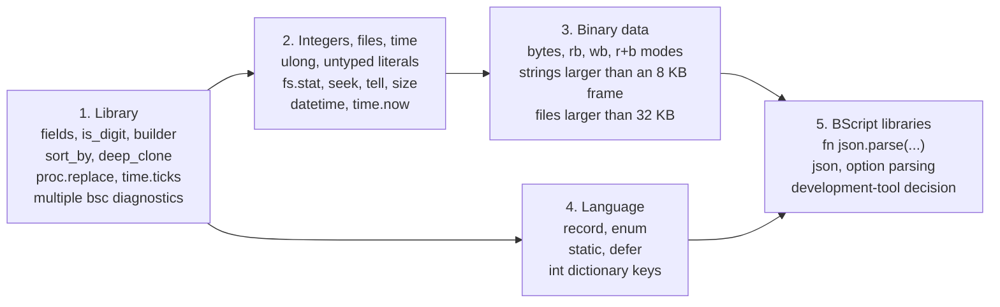

# BScript — Language Development Roadmap

Phase 2 extends BScript in five stages: small library improvements first, followed by `ulong` values and file/time operations, then `bytes` and large objects, records and modules, and finally libraries written in BScript itself. Some of the extended-memory work from the original plan (section 14.8 of version 1.1) was already completed in Phase 1. The corresponding stage is therefore limited to lifting the remaining restrictions. This document supersedes Part II of the version 1.1 specification. The language as implemented is described in *BScript — Language Specification* (`bscript_spec_en.md`); the VM architecture is covered in *BScript — Virtual Machine Architecture* (`bscript_vm_en.md`).

## Starting point: what is already available

Phase 1 has been implemented and verified with tests and ten example programs (`examples/`). The implementation went beyond the original Phase 1 scope: several features initially scheduled for Phase 2 are already present.

| Feature | Version 1.1 plan | Status |
| --- | --- | --- |
| Phase 1 language: `int`, strings, arrays, dictionaries, errors, `switch`, `include`, interpolation | Phase 1 | Implemented |
| `io`, `fs`, `path`, `proc`, `str`, `time.sleep` library APIs | Phase 1 | Implemented |
| Far memory: heap of up to 1 MB in frames, write barrier, segmented arrays and dictionaries | Phase 2 (14.8) | Implemented in Phase 1 |
| Modules spanning several code frames, up to 32 KB of code | Phase 2 (14.8; originally 64 KB) | Implemented in Phase 1, with a 32 KB limit |
| Library overlays and a fast `XMAP` path in Monitor | Not planned | Implemented |
| Compiler that keeps code and constants in extended memory | Not planned | Implemented |
| Second data window and mapping cache | Phase 2 (14.8) | Unnecessary: `XMAP` takes approximately 50 instructions |

**Measured limits that now constrain development:**

- Strings are limited to 32,767 bytes; in far memory, to 7,674 bytes (an object cannot exceed one frame).
- `fs.read_text`, `io.read_all`, and `proc.capture` are limited to 32,767 bytes.
- The near heap is approximately 11.8 KB; the far heap supports 32,512 objects.
- Module code is limited to 32 KB and constants to 16 KB.
- Execution takes approximately 59 CPU16 instructions per bytecode instruction; a call to a user-defined function takes approximately 1,500 instructions.

**Gaps exposed by Phase 1 examples** (used to set priorities):

| Example | What had to be implemented manually | Proposed solution |
| --- | --- | --- |
| `lib/text.bs` | Splitting text into words at spaces and tabs | `s.fields()` |
| `lib/text.bs`, `wordfreq.bs` | Building strings one byte at a time with `cur += str.from_byte(c)` (quadratic time) | String builder; use `s.slice` instead of byte-by-byte concatenation |
| `calc.bs`, `wordfreq.bs` | `is_digit`, `is_alpha`, `is_letter` | Byte classification functions |
| `wordfreq.bs` | Sorting by frequency using a compound string key | Key-based sorting |
| `backup.bs` | Deciding whether a file is new based only on its existence | `fs.stat` with size and timestamp |
| `backup.bs`, `grep.bs` | Parsing command-line options | Option-parsing library |
| `todo.bs`, `calc.bs` | — | Phase 1 features were sufficient |

## Goals and design principles

**The goal of Phase 2** is to make it possible to write in BScript utilities that currently require B16: manipulating binary files and file sizes, comparing modification times, processing files larger than 32 KB, and parsing formats such as JSON.

**The following principles apply to every roadmap item:**

1. **Compatibility.** Phase 1 programs must compile and run unchanged; the new VM must execute format-1 bytecode. New keywords may only come from the reserved set (`enum`, `record`, `static`, `defer`) or namespace names.
2. **Experience before language design.** A feature is scheduled when real use cases demonstrate the need for it. Add library functions before new syntax: a function is less costly than a new operator.
3. **Specify before implementing.** Each feature must receive a specification as precise as the Phase 1 specification, plus tests, before implementation begins. Ambiguities discovered during implementation must be resolved in the specification.
4. **Memory is the primary constraint.** New features must not reduce the near heap available to the resident portion of `bsvm`. Infrequently used, expensive functionality belongs in overlays. Measure the cost of each feature (code size and instructions per operation), as was done in Phase 1.
5. **Do not conceal errors.** Overflow of new types such as `ulong` must raise a runtime error rather than wrap around. I/O failures must continue to produce `error` values.

**Out of scope for Phase 2:** floating-point numbers, first-class functions and closures, multithreading, and a debugger. These may be reconsidered after Phase 2.

## Phase 2 scope

Features are grouped into stages according to their dependencies. Parenthesized numbers refer to section 14 of the version 1.1 specification. Decisions are provisional and will be refined before work begins on each stage.

### Stage 1. Library improvements without language changes

Low-cost additions that replace functionality written by hand in Phase 1 examples. The bytecode format stays unchanged, except for new built-in function and method IDs.

- **Strings:** `s.fields()` splits words at spaces and tabs; `s.index_of_any(set)`, `s.trim_left()`, and `s.trim_right()`.
- **Byte classification** (14.4): `str.is_digit(b)`, `str.is_alpha(b)`, and `str.is_space(b)` follow the CPU16 character encoding, including Cyrillic characters.
- **String builder** (14.4): `str.builder()` provides `append(s)`, `append_byte(b)`, `len()`, and `take()`. The resulting string takes ownership of the buffer without copying it. This avoids the quadratic cost of repeatedly evaluating `cur += str.from_byte(c)`.
- **Key-based sorting** (14.4): `a.sort_by(key)` sorts an array of dictionaries by the value associated with `key`. Since functions are not first-class values, callers cannot supply a comparator.
- **Copying:** `deep_clone(x)` (14.4).
- **Processes and timing:** `proc.replace(name, args)` exposes `EXEC` (14.7); `time.ticks()` exposes `TICKS` (14.6).
- **Compiler:** continue parsing after an error and report multiple diagnostics per invocation (14.9).

### Stage 2. Integers, files, and time

- **`ulong`** (14.1) is an unsigned 31-bit integer (0…2^31 − 1) that requires no heap allocation. Bit 15 of the first value word is zero; the Phase 1 representation already reserves this space. Overflow is a runtime error.
- **Integer literals** become untyped constants, as in B16: their type is determined by the other operand, or defaults to `int` when no context is available. Existing Phase 1 programs retain their meaning.
- Mixing integer types in an operation is a runtime error. Explicit, range-checked conversions use `int(x)` and `ulong(x)`. However, `int` and `ulong` are currently legal variable names; a compatibility rule is needed (open question 1).
- **`uint`** (14.1) proved unnecessary in Phase 1: `>>>` and `str.hex` were sufficient for bitwise work in tests and examples. The proposal is to omit it.
- **Files** (14.5): `fs.stat(path)` returns a dictionary containing the size (`ulong`), attributes, and modification time; `fs.list` exposes the same fields. Add `f.seek(pos)`, `f.tell()`, `f.size()`, `f.skip(n)`, `fs.set_mtime`, `fs.set_attr`, `f.truncate`, and `fs.volinfo`.
- **Time** (14.6): `datetime` uses the FS16 two-word format and compares as a pair of unsigned values. Add `time.now()`, `time.set(dt)`, fields from `year` through `second`, and formatting support.

### Stage 3. Binary data and large objects

- **`bytes`** (14.4) is a mutable byte array with `bytes.new(n)`, indexing, `append`, `slice`, and conversions to and from strings.
- **Binary file modes** (14.5): `"rb"`, `"wb"`, `"ab"`, `"r+b"`, with operations that read and write `bytes` values.
- **Large objects** (14.8): strings and `bytes` spanning multiple frames use a block directory, as arrays and dictionaries already do. This removes the 7,674-byte far-memory limit. Reading an entire file larger than 32,767 bytes is supported only into `bytes`.
- **Object count** (14.8): introduce a paged handle table to exceed 32,512 objects, but only if measurements on real programs demonstrate a need.
- **Module code up to 64 KB** (14.8), should programs of this size appear. Support for multiple code frames already exists; the line and function tables would need 32-bit offsets.

### Stage 4. Language features

- **`record`** (14.2) provides syntactic sugar over arrays: field indices are assigned at compile time, and `e.name` checks that `e` was created using the corresponding `record` definition. This uses less memory and executes faster than a dictionary.
- **`enum`** (14.2) defines named `int` constants for `switch` labels. Duplicate values are errors.
- **`static`** (14.3): `static fn`, `static var`, and `static const` are visible only within the defining file.
- **`defer`** (14.9) performs an action when a function exits, including during error unwinding. Its primary use is closing files.
- **Integer dictionary keys** (14.9).
- **Inline error handling** (14.9) supplies a fallback value without introducing a separate variable. Phase 1 examples could tolerate the extra variable, so this feature remains deferred until there is a demonstrated need.
- **Processes** (14.7): accept open `file` objects instead of paths in `redirect`; allow scripts to catch `proc.BREAK` if that proves necessary.

### Stage 5. Libraries written in BScript

- **Qualified names** (14.3): `fn json.parse(...)` declares a function in the `json` namespace. User-library namespaces do not overlap built-in namespaces.
- **Libraries** (14.10): `json` for parsing and serialization, and shell-style command-line option parsing.
- **Development tools in BScript** (14.10): Phase 1 measurements show that the VM executes approximately 59 CPU16 instructions per bytecode instruction and approximately 1,500 per user-function call, making it substantially slower than B16 code. The proposal is to implement assemblers and compilers in B16 and reserve BScript for scripts and utilities. Experiment with development tools only after Stage 3.

## Roadmap and dependencies

Stage 1 is backward-compatible and can begin immediately. Stage 3 depends on Stage 2's `ulong` for file sizes and offsets above 32,767. Stage 4 builds on Stage 1's library work. BScript libraries require both Stage 3 data support and Stage 4's `static` and qualified names. Each stage is completed only after running all Phase 1 tests and measuring both `bsvm` size and the remaining near heap.

## Risks and open questions

| Risk | Impact | Mitigation |
| --- | --- | --- |
| Growth of the resident `bsvm` image | Every additional 1–2 KB of code removes roughly the same amount from the near heap (currently about 11.8 KB) | Put infrequently used features into overlays; set a resident-size budget per stage and measure after each stage |
| Overlay size limits | An overlay is limited to 8 KB; `sys` already occupies 6.6 KB | Add separate overlays (`time`, `bytes`) rather than expanding existing ones |
| Literal incompatibilities introduced by `ulong` | Phase 1 expression semantics might change | Default to `int` without contextual type information; require the entire Phase 1 suite to pass |
| New bytecode format | Existing `.bsc` files could stop working | Introduce format version 2; support both formats in the VM; have `bs` recompile cached files when their format version changes, as it does today |
| Performance of large programs | JSON handling and format parsing might be too slow | Benchmark in Stage 5 before committing to a library; implement hot paths as B16 built-ins |
| Compiler limits | BScript libraries may hit the 160-function and 32 KB code limits | Review `bsc` limits alongside `static` and qualified names |

**Open questions:**

1. **Conversion names:** `int` is currently an ordinary identifier and can name a variable. Should Stage 1 deprecate such names with a warning, or should conversions use forms such as `ulong.from(x)`?
2. **`datetime` representation:** Should it be a distinct value type or a `ulong` used with `time.*` functions? A distinct type enables `str(dt)` and annotation checking; `ulong` avoids introducing a new type tag.
3. **`record` formatting:** Should `str(e)` display named fields (requiring a name table in `.bsc`) or print the underlying array?
4. **`defer` on fatal errors:** Should deferred actions run when the VM terminates with exit code 125? Currently files are closed automatically on termination.
5. **Module code size:** Is support for modules larger than 32 KB actually needed, or should Stage 3 lift only data-size limits?
6. **`sort_by` stability:** Should sorting be stable at the cost of a second array copy, or unstable like `sort`?
