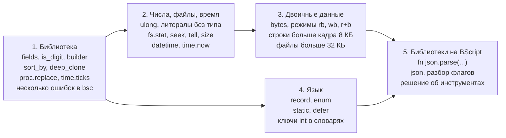

# BScript — план развития языка

Фаза 2 расширяет BScript в пять этапов: сначала мелкие улучшения библиотеки, затем числа `ulong` с файлами и временем, затем `bytes` и большие объекты, записи и модули, и в конце — библиотеки на самом BScript. Часть «расширенной памяти» из прежнего плана (разд. 14.8 версии 1.1) уже сделана в фазе 1, поэтому этот этап сократился до снятия оставшихся пределов. Документ заменяет Часть II спецификации версии 1.1; действующий язык описан в «BScript — спецификация языка» (`bscript_spec_ru.md`), устройство VM — в «BScript — устройство виртуальной машины» (`bscript_vm_ru.md`).

## Исходная точка: что уже есть

Фаза 1 реализована и проверена тестами и десятью примерами (`examples/`). Реализация вышла дальше первоначального плана фазы 1: в ней уже есть часть того, что относилось к фазе 2.

| Возможность | План версии 1.1 | Состояние |
| --- | --- | --- |
| язык фазы 1: `int`, строки, массивы, словари, ошибки, `switch`, `include`, интерполяция | фаза 1 | сделано |
| библиотека `io`, `fs`, `path`, `proc`, `str`, `time.sleep` | фаза 1 | сделано |
| дальняя память: куча до 1 МБ в кадрах, барьер записи, массивы и словари кусками | фаза 2 (14.8) | сделано в фазе 1 |
| модуль в нескольких кадрах кода, до 32 КБ кода | фаза 2 (14.8, было 64 КБ) | сделано в фазе 1, предел 32 КБ |
| оверлеи библиотеки, быстрый путь `XMAP` в мониторе | не планировалось | сделано |
| компилятор с кодом и константами в расширенной памяти | не планировалось | сделано |
| второе окно данных, кеш отображения | фаза 2 (14.8) | не нужно: `XMAP` стоит около 50 команд |

**Измеренные пределы, которые мешают дальше:**

- строка — до 32 767 байт, а в дальней памяти — до 7674 байт (объект не больше кадра);
- `fs.read_text`, `io.read_all`, `proc.capture` — до 32 767 байт;
- ближняя куча — около 11,8 КБ, дальняя — 32 512 объектов;
- код модуля — 32 КБ, константы — 16 КБ;
- скорость — около 59 команд CPU16 на команду байт-кода, вызов функции программы — около 1500 команд.

**Чего не хватило в примерах фазы 1** (основа для приоритетов):

| Пример | Что пришлось писать вручную | Что поможет |
| --- | --- | --- |
| `lib/text.bs` | разбиение на слова по пробелам и табуляциям | `s.fields()` |
| `lib/text.bs`, `wordfreq.bs` | сборка строки побайтно `cur += str.from_byte(c)` (квадратичное время) | построитель строк, `s.slice` вместо побайтной сборки |
| `calc.bs`, `wordfreq.bs` | `is_digit`, `is_alpha`, `is_letter` | классификация байтов |
| `wordfreq.bs` | сортировка по частоте через составной ключ-строку | сортировка с ключом |
| `backup.bs` | «новый ли файл» — только по факту существования | `fs.stat` с размером и временем |
| `backup.bs`, `grep.bs` | разбор ключей командной строки | библиотека флагов |
| `todo.bs`, `calc.bs` | — | хватило фазы 1 |

## Цели и принципы

**Цель фазы 2** — чтобы на BScript можно было писать утилиты, которые сейчас приходится писать на B16: работу с двоичными файлами и их размерами, сравнение по времени изменения, обработку файлов больше 32 КБ, разбор форматов вроде JSON.

**Принципы**, обязательные для каждого пункта плана:

1. **Совместимость.** Программы фазы 1 компилируются и работают без изменений; байт-код формата 1 выполняется новой VM. Новые слова берутся только из зарезервированных (`enum`, `record`, `static`, `defer`) или из имён пространств.
2. **Сначала опыт, потом язык.** Пункт попадает в работу, когда его нехватка видна в настоящих сценариях. Синтаксис добавляется позже библиотеки: функция дешевле нового оператора.
3. **Подробная спецификация до кода.** Каждый пункт перед реализацией описывается так же точно, как фаза 1, и получает тесты. Неясности, найденные при реализации, исправляются в документе.
4. **Память — главный ресурс.** Резидентная часть `bsvm` не должна уменьшать ближнюю кучу; новое редкое и долгое уходит в оверлеи. Цена каждого пункта измеряется (размер кода, команды на операцию) так же, как в фазе 1.
5. **Ошибки не прячутся.** Переполнение новых типов (`ulong`) — ошибка выполнения, а не перенос; ошибки ввода-вывода — значения `error`, как сейчас.

**Не цели фазы 2:** числа с плавающей точкой, функции как значения и замыкания, многопоточность, отладчик. Их пересмотр возможен по итогам фазы 2.

## Состав фазы 2

Пункты сгруппированы в этапы по зависимостям. В скобках — номер пункта в разд. 14 спецификации версии 1.1. Решения предварительные: каждый пункт уточняется перед началом своего этапа.

### Этап 1. Библиотека без изменения языка

Дешёвые добавления, которые закрывают то, что примеры фазы 1 писали вручную. Байт-код не меняется, кроме номеров новых встроенных функций и методов.

- **Строки:** `s.fields()` — слова между пробелами и табуляциями; `s.index_of_any(set)`, `s.trim_left()`, `s.trim_right()`.
- **Классификация байтов** (14.4): `str.is_digit(b)`, `str.is_alpha(b)`, `str.is_space(b)` по кодировке CPU16, включая кириллицу.
- **Построитель строк** (14.4): `str.builder()` с методами `append(s)`, `append_byte(b)`, `len()`, `take()` — строка забирает буфер без копирования. Убирает квадратичную сборку `cur += str.from_byte(c)`.
- **Сортировка по ключу** (14.4): `a.sort_by(key)` — массив словарей, упорядоченный по значению ключа `key`. Функций как значений нет, поэтому компаратор не передаётся.
- **Копирование:** `deep_clone(x)` (14.4).
- **Процессы:** `proc.replace(name, args)` — `EXEC` (14.7); `time.ticks()` — `TICKS` (14.6).
- **Компилятор:** продолжение разбора после ошибки, несколько сообщений за запуск (14.9).

### Этап 2. Числа, файлы и время

- **`ulong`** (14.1) — беззнаковое 31-битное целое (0…2^31 − 1) без кучи: старший бит слова 1 значения равен 0, место для этого оставлено в представлении фазы 1. Переполнение — ошибка выполнения.
- **Литералы** становятся нетипизированными константами, как в B16: тип даёт второй операнд, без контекста — `int`. Смысл программ фазы 1 не меняется.
- Смешанные операции разных целых типов — ошибка выполнения; преобразования явные: `int(x)`, `ulong(x)` с проверкой диапазона. Новые глобальные имена `int`, `ulong` сейчас допустимы как имена переменных — нужно правило совместимости (открытый вопрос 1).
- **`uint`** (14.1) — по опыту фазы 1 не нужен: `>>>` и `str.hex` покрыли битовую работу в тестах и примерах. Предлагается не вводить.
- **Файлы** (14.5): `fs.stat(path)` — словарь с размером (`ulong`), флагами и временем изменения; те же поля в `fs.list`; `f.seek(pos)`, `f.tell()`, `f.size()`, `f.skip(n)`; `fs.set_mtime`, `fs.set_attr`, `f.truncate`, `fs.volinfo`.
- **Время** (14.6): `datetime` в двухсловном формате ФС16, сравнение как беззнаковой пары; `time.now()`, `time.set(dt)`, поля `year`…`second`, форматирование.

### Этап 3. Двоичные данные и большие объекты

- **`bytes`** (14.4) — изменяемый массив байтов: `bytes.new(n)`, индексирование, `append`, `slice`, преобразования в строку и обратно.
- **Двоичные режимы** `"rb"`, `"wb"`, `"ab"`, `"r+b"` (14.5): чтение и запись `bytes`.
- **Большие объекты** (14.8): строки и `bytes` больше кадра хранятся каталогом блоков, как уже хранятся массивы и словари. Снимает предел 7674 байт в дальней памяти; чтение файлов больше 32 767 байт целиком — только в `bytes`.
- **Число объектов** (14.8): страничная таблица handles сверх 32 512 объектов — если измерения на настоящих программах покажут нужду.
- **Код модуля до 64 КБ** (14.8) — если появятся такие программы; механизм нескольких кадров кода уже есть, нужны 32-битные смещения в таблице строк и функций.

### Этап 4. Язык

- **`record`** (14.2) — сахар над массивом: поля получают индексы при компиляции, `e.name` проверяет, что объект создан этим `record`. Меньше памяти и быстрее словаря.
- **`enum`** (14.2) — именованные константы `int` для меток `switch`; повтор значений — ошибка.
- **`static`** (14.3) — `static fn`, `static var`, `static const` видны только в своём файле.
- **`defer`** (14.9) — действие при выходе из функции, в том числе при раскрутке ошибки; главное применение — закрыть файл.
- **Ключи словаря `int`** (14.9).
- **Обработка ошибки по месту** (14.9) — запасное значение без отдельной переменной. В примерах фазы 1 перехвата лишней переменной хватало; пункт отложен до появления нужды.
- **Процессы** (14.7): открытые `file` вместо путей в `redirect`; перехват `proc.BREAK` сценарием — если окажется нужным.

### Этап 5. Библиотеки на BScript

- **Квалифицированные имена** (14.3): `fn json.parse(...)` объявляет функцию пространства `json`; пространства библиотек не совпадают со встроенными.
- **Библиотеки** (14.10): `json` (разбор и вывод), разбор флагов командной строки в стиле утилит оболочки.
- **Инструменты разработки на BScript** (14.10) — по измерениям фазы 1 VM тратит около 59 команд CPU16 на команду байт-кода и около 1500 на вызов функции, то есть заметно медленнее кода B16. Предлагается писать ассемблер и компиляторы на B16, а BScript оставить для сценариев и утилит; эксперимент — только после этапа 3.

## Дорожная карта

Этап 1 ничего не ломает и начинается сразу. Этап 3 опирается на `ulong` этапа 2 (размеры и позиции больше 32 767), этап 4 — на библиотеку этапа 1, а библиотеки на BScript требуют и данных этапа 3, и `static` с квалифицированными именами этапа 4. Каждый этап закрывается прогоном всех тестов фазы 1 и измерением размера `bsvm` и ближней кучи.

## Риски и открытые вопросы

| Риск | Чем грозит | Ответ |
| --- | --- | --- |
| рост резидентной части `bsvm` | каждые 1–2 КБ кода — минус столько же ближней кучи (сейчас около 11,8 КБ) | новое редкое — в оверлеи; бюджет резидентной части на этап, измерение после каждого этапа |
| бюджет оверлеев | оверлей не больше 8 КБ, `sys` уже 6,6 КБ | новые оверлеи (`time`, `bytes`) вместо роста существующих |
| несовместимость литералов при `ulong` | смысл выражений фазы 1 мог бы измениться | правило «без контекста — `int`» и прогон всех тестов фазы 1 как обязательный |
| новый формат байт-кода | старые `.bsc` перестанут выполняться | версия формата 2, VM выполняет обе; `bs` перекомпилирует кеш по версии, как сейчас |
| скорость больших программ | `json` и разбор форматов могут оказаться медленными | измерение на этапе 5 до решения о библиотеке; горячие части — встроенные функции на B16 |
| пределы компилятора | 160 функций и 32 КБ кода у библиотек на BScript | пересмотр пределов `bsc` вместе с `static` и квалифицированными именами |

**Открытые вопросы:**

1. Имена `int`, `ulong` как функции преобразования: сейчас `int` — обычный идентификатор и может быть именем переменной. Запретить такие имена с предупреждением в этапе 1 или ввести преобразования как `ulong.from(x)`?
2. `datetime` — отдельный тип значения или `ulong` с функциями `time.*`? Отдельный тип даёт `str(dt)` и проверку аннотаций, `ulong` не требует нового тега.
3. `record` и `str(e)`: печатать поля по именам (нужна таблица имён в `.bsc`) или как массив?
4. `defer` при ошибке выполнения: выполнять ли отложенные действия, когда VM останавливается с кодом 125? Сейчас при остановке файлы закрываются сами.
5. Нужен ли код модуля больше 32 КБ, или пределы этапа 3 стоит ограничить данными?
6. Сортировка `sort_by`: устойчивая ценой второй копии массива или неустойчивая, как `sort`?
